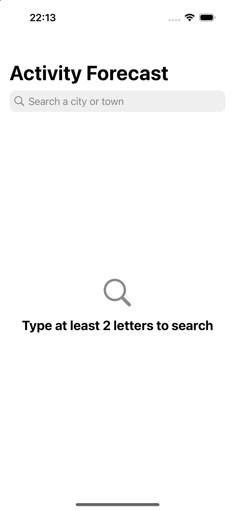

# Activity Forecast (iOS)

Search for a city or town and see how good each of the next 7 days is for **skiing, surfing, outdoor sightseeing and indoor sightseeing**. The four activities are ranked for the week. Every day gets a 0–100 score (Poor / Fair / Good / Excellent) and a plain-language reason, and each activity's best day is starred.

Weather comes from Open-Meteo's [Geocoding](https://open-meteo.com/en/docs/geocoding-api) and [Forecast](https://open-meteo.com/en/docs) APIs. There is no backend and no API key.



## Run it

Requirements: Xcode 27+ (Swift 6.4 toolchain), iOS 18+ simulator. The app is universal: iPhone, iPhone Duo (both displays) and iPad at every window size. Nothing to install: no third-party dependencies, native `.xcodeproj`. [SwiftLint](https://github.com/realm/SwiftLint) is only needed for the lint gate.

```bash
open ActivityForecast.xcodeproj      # scheme "ActivityForecast", any iPhone, iPhone Duo or iPad simulator, ⌘R
```

Tests:

```bash
swift test --package-path Packages/ForecastKit          # domain, scoring, data (≈ 0.02 s, no simulator)
xcodebuild test -project ActivityForecast.xcodeproj -scheme ActivityForecast \
  -destination 'platform=iOS Simulator,name=iPhone 16'  # also the app's view-model tests (ActivityForecastTests)
swiftlint lint --strict                                 # PR gate: zero violations (.swiftlint.yml)
```

The app icon is original artwork committed as PNGs (Default, Dark and Tinted) in `App/Resources/Assets.xcassets/AppIcon.appiconset/`.

The manual end-to-end checks are listed in [`specs/001-activity-forecast-ranking/quickstart.md`](specs/001-activity-forecast-ranking/quickstart.md), and the device and window-size matrix in [`specs/003-universal-adaptive-layout/quickstart.md`](specs/003-universal-adaptive-layout/quickstart.md).

## How I worked

Process first, code second. Every step left an artifact in the repo:

1. **Intent**: [`intent.md`](intent.md) distils the brief into goals, hard constraints, what reviewers value, committed assumptions and non-goals.
2. **Specification** ([Spec Kit](https://github.com/github/spec-kit)): [`spec.md`](specs/001-activity-forecast-ranking/spec.md) holds the user stories, testable requirements (FR-001…016) and measurable success criteria. Its *Clarifications* section records each decision as it was made: layered MVVM, a native Xcode project, TDD, and the best-day threshold.
3. **Plan and research**: [`plan.md`](specs/001-activity-forecast-ranking/plan.md) covers the architecture and workflow. [`research.md`](specs/001-activity-forecast-ranking/research.md) logs the decisions (R1–R13) and the alternatives rejected. Data model and contracts sit alongside.
4. **Tasks → GitHub**: [`tasks.md`](specs/001-activity-forecast-ranking/tasks.md) became one issue per phase (#1–#6) and one per task (#10–#45). Each phase is a stacked pull request.
5. **Test-driven implementation**: every behaviour landed as a `test: … (red)` commit followed by a `feat: … (green)` commit, so the history shows each test failing before the code that makes it pass. Work was split across AI subagents (scoring and the API client in parallel, then the screens), and every hand-off was **re-verified independently** on a fresh clone before it was accepted.

### Verification, and what it caught

AI wrote most of the code. These checks were the guard against unverified output:

- **API shapes were checked live** before the contract was written (e.g. a geocoding search with no matches *omits* `results`; snow depth only exists hourly, in metres). The test fixtures are recorded live responses.
- **Scoring weights were worked through by hand** against four reference weeks before any code. The first draft **failed**: the rainy city ranked Surfing above Indoor. The weights were corrected and the reference weeks became tests (`WeeklyRankerTests`).
- **A live end-to-end run** (real client → ranker, for Paris, Chamonix, London and Nazaré) found a real bug: Chamonix with **0 cm of snow scored Skiing "Fair" with a ★**, because the no-snow cap only applied above freezing. It was fixed test-first (T034, issue #45).
- **Not verified by me**: driving the UI in the simulator (no UI automation was available in this environment). Screens are covered by SwiftUI previews for every state and by the manual checklist in `quickstart.md`. The view models behind them are unit-tested.

## Architecture

Layered **MVVM** with one-way dependencies (`App → ForecastKit → Foundation`):

```
App/ (views)                         RootView (NavigationSplitView): Search | Forecast → Day detail sheet
  ↓ observes / calls
App/Features (view models)           BrowseModel → SearchModel, ForecastModel  (@Observable, MainActor by default, LoadState)
  ↓ uses
ForecastKit/Scoring + Models         ActivityScorer, WeeklyRanker: pure, deterministic
ForecastKit/Service                  WeatherService ← OpenMeteoClient (URLSession + Codable), UserFacingError
```

- Domain, scoring and data live in a local Swift package, tested with `swift test` (no simulator). View models live in the app and are tested in the hosted `ActivityForecastTests` target.
- Test doubles never ship: `StubWeatherService` and the preview data are `internal` app fixtures (shared by previews and tests). Release whole-module optimisation removes them, verified with `nm` (0 symbols).
- Search is debounced (300 ms) with `.task(id:)`. Superseded requests are cancelled, and a stale result can never overwrite a newer one (tested).
- Each screen has one explicit `LoadState` (idle / loading / loaded / empty / failed + Retry).
- The layout follows the window's width class, never the device: wide windows (iPad, iPhone Duo inner display) show search and forecast side by side, narrow ones collapse to search → forecast → Back. `BrowseModel` owns the search, selection, forecast and open day, so a fold, rotation or resize keeps them without fetching again (tested).
- `LocalDate` keeps forecast days as calendar components in the place's time zone, so the device time zone can never shift a day.

## Scoring model

Each activity's daily score is a weighted sum of weather factors, each normalised to 0…1 by piecewise-linear ramps, with hard caps for conditions that rule the activity out. The full table is in [research.md R9](specs/001-activity-forecast-ranking/research.md).

| Activity | Driven by | Capped when |
|---|---|---|
| Skiing | snowfall + snow depth, cold, light gusts, no rain | no snow at all → ≤ 10 |
| Surfing | moderate wind (15–35 km/h), warmth, dry | thunderstorm → ≤ 10 |
| Outdoor sightseeing | comfortable 15–25 °C, dry, calm, sunshine | thunderstorm or ≥ 2 cm snow → ≤ 20 |
| Indoor sightseeing | 30 + 0.6 × (100 − outdoor) | always 30–90: never below Fair |

Weekly score = mean of the days that have data ("No data" days are excluded, never counted as 0). Activities are ranked by weekly score, then best single day, then a fixed order. A best day is starred only if it reaches Fair (≥ 25); otherwise the activity shows "No suitable day this week".

## Assumptions and limitations

- **Surfing is weather-only.** The Forecast API has no wave or swell data and the brief limits sources to the two APIs, so the app labels surfing accordingly. Adding the Open-Meteo Marine API would be the next step.
- **Model elevation.** Forecasts are for the grid cell (e.g. ~1,030 m for Chamonix), not ski-resort altitude, so mountain snow can be understated.
- The scores are a transparent heuristic, not a validated model. The rainy-city margin (Indoor 65 vs Surfing 55) is the closest call and is pinned by a test.
- **Search needs Latin script.** Open-Meteo geocoding returns nothing for non-Latin queries (e.g. `東京`, `Москва`), so the app shows "No places found"; `Tokyo` works. Accented names such as `Zürich` are fine.
- Online only. No accounts, favourites, history or caching. Metric units, English.
- 7 days = today + 6, in the selected place's local time zone.

## Trade-offs

- **No third-party code**: there are only two GET endpoints. `URLSession` + `Codable` + Swift Testing covers it, and there is nothing to vet or update.
- **One package, not several modules**: about 25 source files don't justify more boundaries. The package line already keeps views away from networking.
- **No UI test suite**: XCUITests cost a lot to keep up for three screens. The logic is tested underneath and previews cover the states. With more time, I'd add one smoke UI test (search → forecast).
- **iOS 18 minimum, Xcode 27 toolchain**: the deployment target stays at iOS 18, but building needs the Swift 6.4 toolchain (constitution Principle II). APIs newer than iOS 18 need `if #available`.
